<div align="center">


# Shots

**Your screenshots, named and filed by what's actually in them.**

A macOS menu-bar app and command-line tool that reads each screenshot with on-device
Vision OCR, works out what it shows, gives it a descriptive filename, and files it
into folders by topic or by day.

[](https://github.com/stawan15/shots/actions/workflows/ci.yml)
[](#requirements)
[](Package.swift)
[](LICENSE)

<table>
<tr>
<td></td>
</tr>
</table>

</div>

---

## Contents

- [Overview](#overview)
- [Before and after](#before-and-after)
- [Requirements](#requirements)
- [Installation](#installation)
- [Usage](#usage)
  - [Menu-bar app](#menu-bar-app)
  - [Command line](#command-line)
- [Updates](#updates)
- [How it works](#how-it-works)
- [Organisation layouts](#organisation-layouts)
- [Configuration](#configuration)
- [Command reference](#command-reference)
- [Sharing the CLI with the app](#sharing-the-cli-with-the-app)
- [Data safety](#data-safety)
- [Building from source](#building-from-source)
- [Project structure](#project-structure)
- [Contributing](#contributing)
- [License](#license)

## Overview

Screenshot folders rot. macOS names every capture `Screenshot 2026-11-06 at 13.45.38.png`,
so finding the one dashboard you need means opening forty images. The usual answer is
a cloud AI service: an API key, an upload of your work screens, and a monthly bill.

Shots does the work locally. Apple's Vision framework ships on every Mac with strong
OCR and image classification; Shots puts an opinionated layer on top — topic rules,
readable-title selection, and safe file moves — so the folder organises itself.

- **On-device.** No network calls, no API keys, no model downloads. Works offline.
- **Descriptive names.** `2026-11-06-1345-teams-meeting-devops-team-chat.png`, not a timestamp.
- **Filed for you.** By day, by topic, or both.
- **Nothing is destroyed.** Dry runs by default, undo journals, never overwrites.
- **Two front ends.** A menu-bar app for reviewing, and a CLI for scripting.
- **Free and open source.** MIT licensed, no account required.

## Before and after

| Before | After |
| --- | --- |
| `Screenshot 2569-11-06 at 13.45.38.png` | `2026-11-06-1345-teams-meeting-devops-team-chat.png` |
| `Screenshot 2569-11-04 at 15.43.44.png` | `2026-11-04-1543-zabbix-current-value.png` |
| `Screenshot 2569-11-06 at 13.07.55.png` | `2026-11-06-1307-terminal-docker-ps-web-01.png` |
| `Screenshot 2569-11-05 at 14.12.01.png` | `2026-11-05-1412-grafana-team-kubernetes-node-exporter.png` |

## Requirements

| | |
| --- | --- |
| Operating system | macOS 14 (Sonoma) or later |
| Architecture | Apple silicon or Intel |
| Building from source | Swift 6.0+ (CommandLineTools is sufficient, Xcode is not required) |
| Prebuilt app | None — the DMG is self-contained |

## Installation

### Prebuilt application (recommended)

Download `Shots.dmg` from the [latest release](https://github.com/stawan15/shots/releases),
open it, and drag **Shots** onto the Applications folder.

The build is not notarized by Apple (that requires a paid Developer ID). On first
launch macOS may report that the developer cannot be verified. Do one of:

- Right-click `Shots.app` in Applications, choose **Open**, then **Open** again; or
- Run `xattr -dr com.apple.quarantine /Applications/Shots.app`

After that it launches normally.

### From source

```sh
git clone https://github.com/stawan15/shots.git
cd shots

./install.sh          # command-line tool  -> ~/.local/bin/shots
./build-app.sh        # menu-bar app       -> dist/Shots.app
./build-dmg.sh        # installer image    -> dist/Shots.dmg
```

`install.sh` warns you if `~/.local/bin` is not on your `PATH`.

## Usage

### Menu-bar app

Shots lives in the menu bar and has no Dock icon.

| Action | Result |
| --- | --- |
| Left-click the icon | Opens the popover with pending screenshots |
| Right-click the icon | Menu: About, Check for Updates, Scan Now, Open Screenshots Folder, Quit |
| Checkbox per row | Include or exclude that screenshot from the next filing |
| **File All** | Moves the checked screenshots and writes an undo journal |
| **Undo** | Restores the most recent batch to its original paths |
| **Settings…** | Watched folders, destination, layout, custom rules |
| **File new screenshots automatically** | Scans every 60 seconds while running |

Each row shows a thumbnail, the original filename, the new filename, and the topic
folder it will be filed under. The menu-bar icon displays how many screenshots are
waiting.

### Command line

```sh
shots plan            # preview every rename and move; touches nothing
shots apply --yes     # perform the plan
shots undo            # put the last batch back exactly as it was
shots list            # previous batches
```

Keep it running in the background:

```sh
shots watch --interval 20      # foreground loop
shots agent install            # launchd job that starts at login
```

## Updates

Shots updates itself.

- **Check for Updates…** in the right-click menu shows the release notes and installs
  in one click.
- A check runs at most once a day at launch and says nothing when you are current.
  Turn it off with **Check Automatically** in the same menu.
- The download is verified against the SHA-256 digest GitHub publishes for the
  release before anything is executed. A mismatch aborts the install.
- The swap is transactional: the previous bundle is kept aside and restored if the
  install fails, so a bad update cannot leave you without a working app.
- After installing, the quarantine flag is cleared and the bundle is re-signed ad-hoc
  so Gatekeeper still launches it.

From the command line:

```sh
shots update --check     # report whether a newer version exists
shots update             # prompt, then install
shots update --yes       # install without prompting
```

The CLI replaces the binary it was launched from, keeping its location and
permissions, and pulls the new copy out of the release DMG.

> Version 1.1.0 shipped before the updater existed, so it needs a single manual
> download. Every version from 1.2.0 onwards can update itself.

## How it works

1. **Text recognition.** Vision OCR runs in accurate mode with English and Thai
   enabled by default.
2. **Topic scoring.** Each topic carries weighted keywords, so `grafana` counts for
   a lot while `datasource` only adds a little. The highest total wins, which means a
   JMeter page that happens to contain a Keycloak login URL is still filed under
   `testing` rather than `auth`. Generic single keywords never reach the routing
   threshold; unclear screenshots go to `misc` instead of being mislabelled.
3. **Title selection.** For terminal captures the title is the command at the shell
   prompt (`docker ps web-01`). Otherwise it is the most readable line near the top
   of the image, scored for real words and penalised for identifier soup, query
   strings and OCR-mangled Thai.
4. **Slug construction.** Everything is reduced to ASCII, UI chrome words such as
   `search`, `dashboard` and `edit` are dropped, and the result is capped at 70
   characters.

Capture time is taken from the original filename, so it survives copying and
mailing, and the Thai Buddhist year is converted (`2569` becomes `2026`).

Built-in topics:

| Folder | Recognises |
| --- | --- |
| `monitoring` | Grafana, Zabbix |
| `testing` | JMeter |
| `ci-cd` | GitHub Actions, GitLab, Jenkins |
| `auth` | Keycloak, single sign-on portals |
| `database` | DBeaver, PostgreSQL |
| `chat` | Microsoft Teams, Slack |
| `docs` | Confluence, Notion |
| `terminal` | shell prompts, SSH sessions |
| `errors` | certificate failures, stack traces |
| `code` | editors |
| `learning` | quiz and lesson screens |

## Organisation layouts

Select with `--layout` or in Settings.

| Mode | Result |
| --- | --- |
| `day` *(default)* | `~/Screenshots/2026-11-06/2026-11-06-1345-grafana-cpu.png` |
| `topic` | `~/Screenshots/monitoring/2026-11-06-1345-grafana-cpu.png` |
| `both` | `~/Screenshots/monitoring/2026-11-06/2026-11-06-1345-grafana-cpu.png` |

## Configuration

Settings live in `~/.config/shots/config.json` and are shared by the app and the CLI.

```json
{
  "sources": ["/Users/you/Desktop", "/Users/you/Downloads"],
  "destination": "/Users/you/Screenshots",
  "layout": "day",
  "languages": ["en-US", "th-TH"],
  "rules": [
    {
      "folder": "work/client-a",
      "tag": "clienta",
      "keywords": ["acme portal", "ticket 42"]
    }
  ]
}
```

Custom rules are evaluated before the built-ins, and a single matching keyword is
enough to route a screenshot:

```sh
shots config --edit                     # open in $EDITOR
shots config --add-source ~/Downloads
shots config --remove-source ~/Downloads
shots config --destination ~/Screenshots
shots config --layout topic
shots config --print
```

## Command reference

| Command | Description |
| --- | --- |
| `shots plan` | Dry run. Prints every source and destination, grouped by folder. |
| `shots apply --yes` | Performs the plan and writes an undo journal. |
| `shots undo` | Reverts the most recent batch. Repeat to go further back. |
| `shots list` | Lists past batches, newest first. |
| `shots watch` | Long-running loop that files new captures. |
| `shots agent install` | Installs the launchd job. Also `status`, `log`, `uninstall`. |
| `shots config` | Reads or changes settings. |
| `shots debug PATH` | Prints OCR lines, Vision labels and the chosen name. |
| `shots update` | Checks for and installs a newer release. Also `--check`, `--yes`. |
| `shots version` | Prints the version. |

Options for `plan`, `apply` and `watch`:

| Option | Description |
| --- | --- |
| `-d`, `--dir DIR` | Folder to scan. Repeatable. Defaults to the configured sources. |
| `--to DIR` | Destination root for this run only. |
| `--layout MODE` | `day`, `topic` or `both` for this run only. |
| `--all` | Also move images that do not look like screenshots. |
| `-y`, `--yes` | Required before `apply` moves anything. |
| `--json` | Emits the plan as JSON for scripting. |
| `-q`, `--quiet` | Suppresses progress output. |

The application binary also accepts `--once` (scan, file and exit) and
`--preview out.png` (render the popover to an image).

## Sharing the CLI with the app

Both front ends use the same engine, configuration and undo journals, so they can be
used interchangeably. A typical setup is the menu-bar app for reviewing at the end of
the day and `shots watch` for unattended filing.

## Data safety

Screenshots are work you cannot regenerate, so the defaults are deliberately cautious.

- `plan` never modifies files, and `apply` refuses to act without `--yes`.
- Only files named `Screenshot …`, `CleanShot …`, `capture …` and similar are moved.
  Other images require `--all`; photos then go to `images/`.
- Byte-identical duplicates are reported and left untouched.
- Files are never overwritten. Collisions receive a `-2` or `-3` suffix, and a
  different candidate title is preferred over a suffix when one is available.
- Every applied batch is journaled, so `undo` restores exact original names and paths.

## Building from source

```sh
swift build -c release
swift run -c release shots-selftest        # routing and naming checks
swift run -c release shots debug ~/Desktop/shot.png
```

Building the distributables:

```sh
VERSION=1.1.0 ./build-app.sh     # dist/Shots.app
VERSION=1.1.0 ./build-dmg.sh     # dist/Shots.dmg
```

The version is defined once in `Sources/ShotsCore/Version.swift`; the build scripts
read it from there, and the release workflow fails if a git tag disagrees with it.

The application is written in AppKit rather than SwiftUI: a CommandLineTools-only
toolchain ships without SwiftUI's macro plugin, so `@State` and `@Published` fail to
expand. AppKit needs nothing beyond the standard toolchain, and full Xcode builds the
same code unchanged.

## Project structure

```
Sources/ShotsCore/       engine — Vision analysis, naming rules, planning, journals
Sources/shots/           command-line interface
Sources/ShotsApp/        menu-bar application (AppKit)
Sources/shots-selftest/  self-checks, since this toolchain has no XCTest
assets/Shots.icns        application icon
docs/                    screenshots used by this README
build-app.sh             assembles dist/Shots.app
build-dmg.sh             assembles dist/Shots.dmg
```

Adding a topic is a single entry in `Sources/ShotsCore/Namer.swift`:

```swift
Rule(folder: "infra", tag: "terraform",
     weighted: ["terraform apply": 5, "plan:": 2, "aws_": 2])
```

## Contributing

Issues and pull requests are welcome. See [CONTRIBUTING.md](CONTRIBUTING.md) for the
development workflow and the guidance on adding topics. If a filename looks wrong,
`shots debug path/to/image.png` prints the OCR text and the scoring that produced it,
which is usually enough to diagnose the rule.

## License

Released under the [MIT License](LICENSE).

Shots is not affiliated with Apple. Apple, macOS and Vision are trademarks of Apple Inc.
